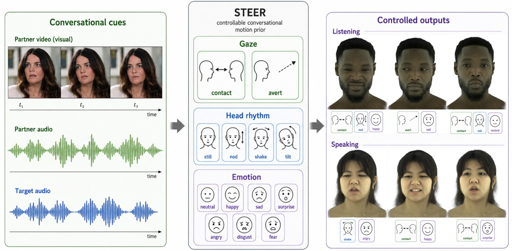

# STEER: Steerable Dyadic Head Avatars — Inference Code

[**Project page**](https://kartik-teotia.github.io/STEER/) ·
[**Paper (PDF)**](https://kartik-teotia.github.io/STEER/assets/paper/STEER_arxiv.pdf)



Official inference code for **STEER** (SIGGRAPH Asia 2026). STEER is a causal
flow-matching motion prior that generates a target person's 3D facial motion
(61-D FLAME state: expression, jaw, neck, eye rotation, eyelids) in two-person
conversation, conditioned on the partner's motion and audio and the target's
own audio, with explicit semantic controls over gaze, head rhythm, and
emotion.

This repository contains the motion prior + motion autoencoder inference
pipeline and a FLAME visualization (including eyeball /
iris / pupil and eyelid rendering). Given a packaged example (partner motion,
partner audio, target audio, partner gaze cue), it generates the target's
motion and writes a side-by-side video: the partner's tracked motion and the
generated target motion, both rendered as FLAME meshes.

## Setup

```bash
conda create -n steer python=3.10 -y && conda activate steer
pip install -r requirements.txt
```

`ffmpeg` must be on your PATH. Rendering uses EGL headless OpenGL
(`PYOPENGL_PLATFORM=egl`, set automatically); a GPU is required.

### Required assets (not redistributable by us)

1. **FLAME 2020**: register at <https://flame.is.tue.mpg.de>, download
   *FLAME 2020*, and place `generic_model.pkl` at
   `assets/FLAME2020/generic_model.pkl`.
2. **Checkpoints**: download `steer_prior.pt` (639 MB), `motion_ae.pt` (6 MB),
   and `stats_61d.npz` from the release page (link TBA) into `checkpoints/`.
3. The Wav2Vec2 audio encoder (`facebook/wav2vec2-large-960h`) downloads
   automatically from the Hugging Face hub on first run.

Bundled with attribution: SMIRK's eyelid blendshapes
(`steer/flame/blendshapes/`, from [SMIRK](https://github.com/georgeretsi/smirk))
and the FLAME/MediaPipe landmark embeddings used by the FLAME module.

## Run the examples

Six examples from RealTalk are packaged under
`examples/` (tracked partner motion + per-speaker audio + partner-gaze cue;
three listening, two speaking, one mirror-laugh). No RealTalk video frames are
redistributed --- examples contain derived features only:

```bash
# base generation (no semantic controls)
python run_inference.py --example examples/listen_laugh_y8lxhe7iBcE

# semantic control edits (gaze x head-rhythm x emotion, freely combinable)
python run_inference.py --example examples/speak_WfYmsNBQwg8 --head nod --emotion happy
python run_inference.py --example examples/speak_WfYmsNBQwg8 --head shake
python run_inference.py --example examples/speak_Awu5Pgd2Oe4 --gaze avert --emotion disgust
python run_inference.py --example examples/listen_normal_A4jnhOZK8iY --emotion happy
```

Output lands in `<example>/output/steer_<controls>.mp4` (side-by-side video
with audio) and `steer_<controls>.npz` (the raw 61-D motion).

Controls: `--gaze {contact, avert}`, `--head {still, nod, shake, tilt}`,
`--emotion {neutral, happy, sad, surprise, angry, disgust, fear}`. Head-shake
is a speaking-behavior class; request it on speaking examples. All control
runs use the default recipe (`steer/controls.py: RECIPE`): audio CFG
1.5, behavior CFG 2.0, emotion strength 1.2, 10-step rectified-flow sampling.

## Example folder format

Each example is self-contained:

```
examples/<name>/
└── inputs.npz     # partner_motion61 (T,61), prev_motion61 (12,61),
                   # target_audio (T*640,), partner_audio (T*640,),
                   # partner_gaze (T,3), n_frames, prefix, category
```

To run STEER on your own dyadic data, produce this format: 61-D SMIRK/FLAME
tracking of the partner (exp50 + jaw3 + neck3 + eye3 + eyelid2 at 25 fps),
16 kHz per-speaker audio, and the 3-D partner-gaze cue
(frame-on-partner flag, head deviation / 30, eye deviation / 20).

## Repository layout

```
run_inference.py      # entry point
steer/                # inference package
├── loader.py         #   checkpoint loading (prior + causal motion AE)
├── generate.py       #   chunked streaming generation
├── controls.py       #   semantic-control timelines + default recipe
├── render.py         #   FLAME rendering with eyeball/iris/pupil + eyelids
├── video.py          #   side-by-side composition + audio mux
├── rotations.py      #   pytorch3d-free rotation conversions
└── flame/            #   FLAME module (from DualTalk/SMIRK lineage)
models/               # network definitions (prior, motion AE, audio encoder)
checkpoints/          # weights (download; see above)
examples/             # six packaged examples
```

## Citation

```bibtex
@inproceedings{teotia2026steer,
  author    = {Teotia, Kartik and Rhodin, Helge and Kim, Hyeongwoo and
               Habermann, Marc and Theobalt, Christian},
  title     = {STEER: Steerable Dyadic Head Avatars},
  booktitle = {SIGGRAPH Asia 2026 Conference Papers},
  year      = {2026},
}
```

## License and acknowledgements

Our code, checkpoints, and packaged example features are released under the
[CC BY-NC 4.0](https://creativecommons.org/licenses/by-nc/4.0/) license
(attribution, non-commercial); see `LICENSE`. Third-party components --- the
FLAME model (user-downloaded from <https://flame.is.tue.mpg.de>), the
FLAME/smplx-derived code in `steer/flame/` (original MPG copyright headers
retained), and the bundled small assets --- remain under their own terms; see
`NOTICE.md` for the full inventory. FLAME is subject to its own
license (<https://flame.is.tue.mpg.de>); the RealTalk source videos are not
redistributed — the examples package derived motion/audio features only.
Eyelid blendshapes courtesy of SMIRK (Retsinas et al., CVPR 2024); the FLAME
module derives from the DualTalk/SMIRK code lineage.
